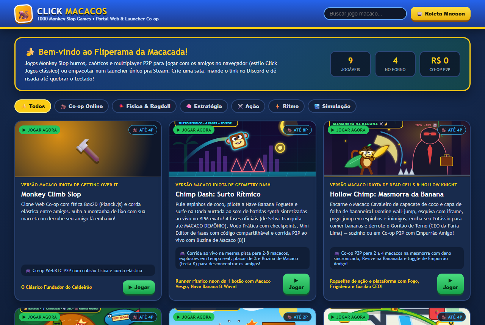
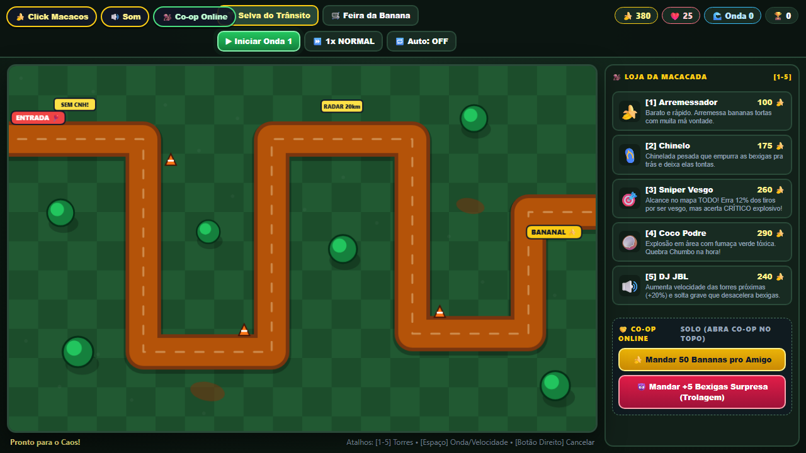
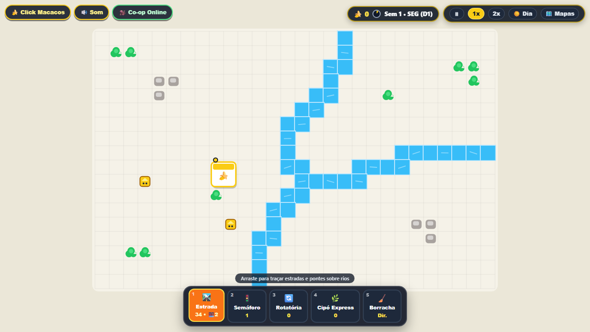
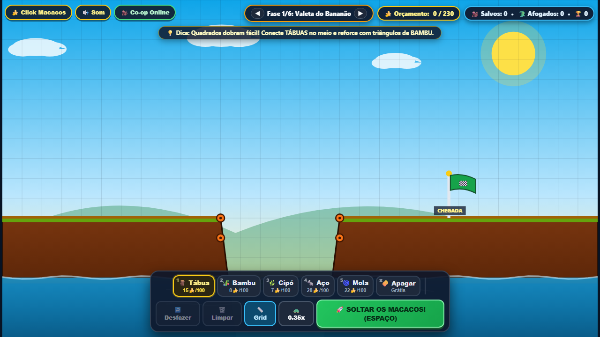
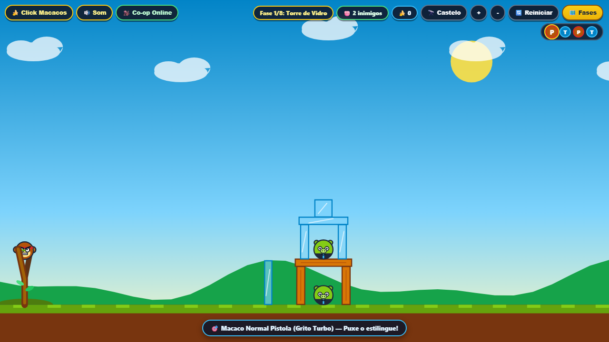
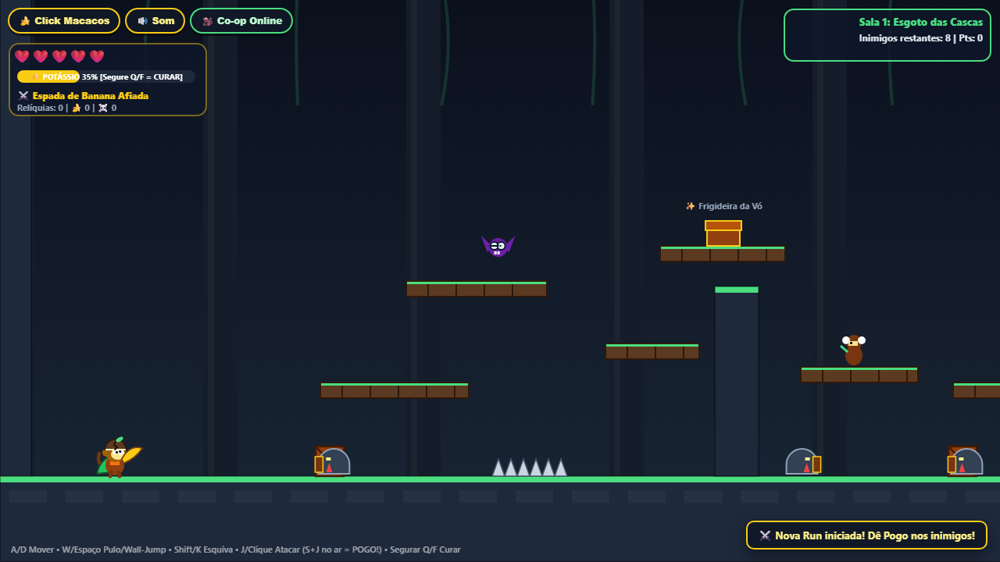
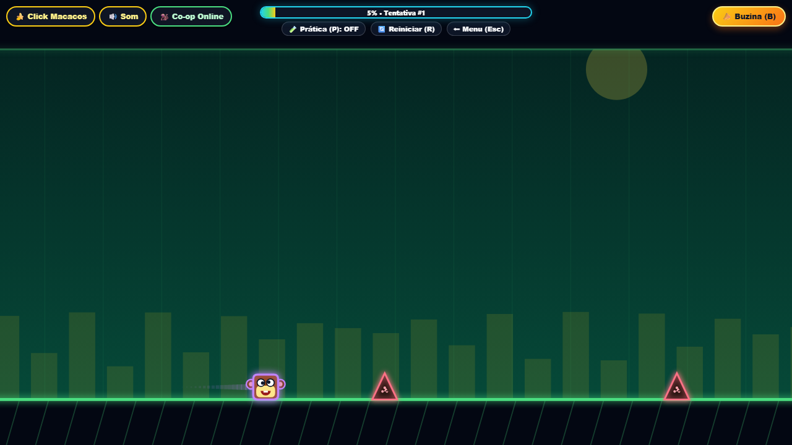
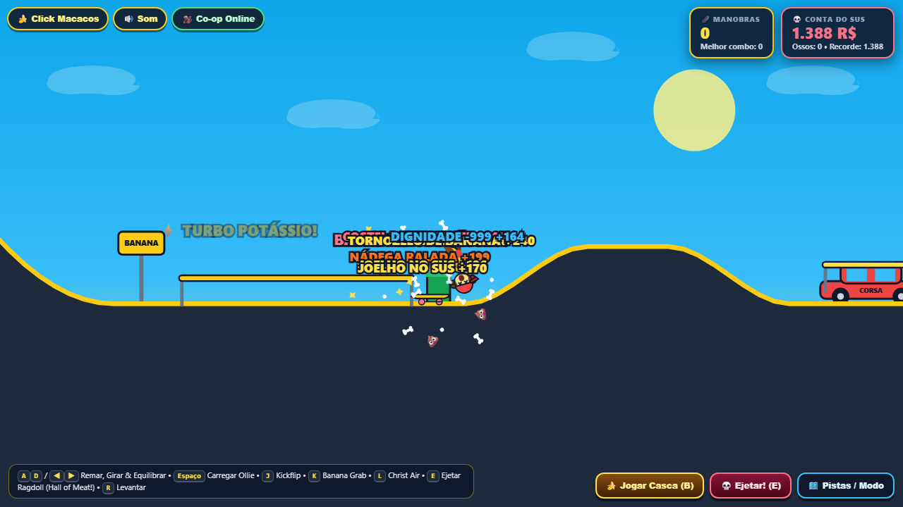
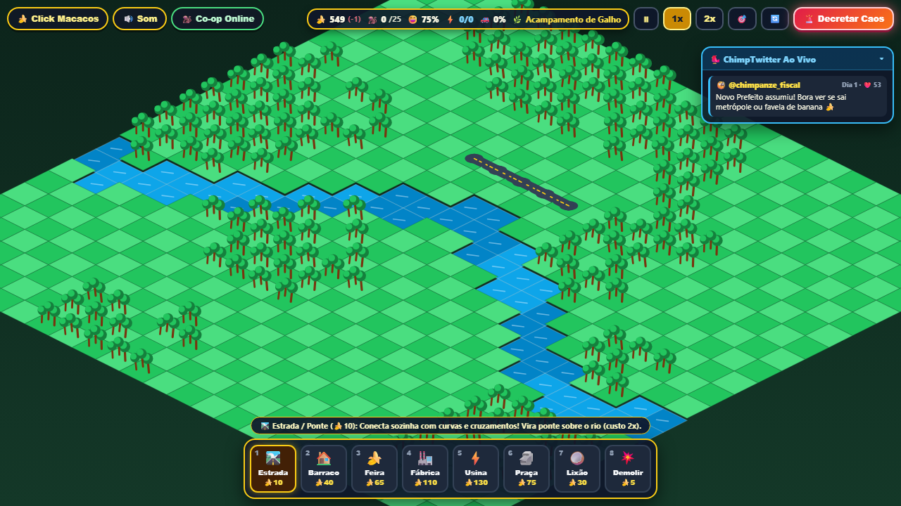

<div align="center">


# 🐒 Click Macacos — 1000 Monkey Slop Games

**O portal arcade estilo *Click Jogos* reunindo uma coleção caótica, hilária e 100% jogável de jogos Monkey Slop — com Multiplayer P2P grátis direto no navegador!**

[](https://brenosgto.github.io/1000-monkey-games/)
[](#-multiplayer-p2p-instantâneo)
[](#-arquitetura--stack)
[](./ARCHITECTURE.md)

<br>

### 👉 [**CLIQUE AQUI PARA JOGAR AGORA EM `brenosgto.github.io/1000-monkey-games`**](https://brenosgto.github.io/1000-monkey-games/) 👈

</div>

---

## 🖥️ O Portal Click Macacos

Navegue por todos os jogos num launcher único com filtros por categoria, busca rápida, **Roleta Macaca** para sortear um jogo aleatório, recordes locais e player em tela cheia:

<div align="center">
  
</div>

---

## 📸 Prints dos Jogos em Ação

<table>
  <tr>
    <td align="center" width="50%">
      
      <br><b>🎈 Macaco Estoura-Bexiga TD</b><br>
      <sub>Tower Defense caótico com macacos vesgos, chineladas e Dirigível do Imposto</sub>
    </td>
    <td align="center" width="50%">
      
      <br><b>🛣️ Mini Macacoways</b><br>
      <sub>Caos minimalista no trânsito da selva com pontes, rotatórias e Cipó Express</sub>
    </td>
  </tr>
  <tr>
    <td align="center" width="50%">
      
      <br><b>🌉 Ponte de Cipó & Gambiarra</b><br>
      <sub>Engenharia primata com física real de tensão, bambu, molas e rio de jacarés</sub>
    </td>
    <td align="center" width="50%">
      
      <br><b>🎯 Macacos Pistola</b><br>
      <sub>Estilingue Box2D contra fortalezas de Porcos Faria Limers e TNT</sub>
    </td>
  </tr>
  <tr>
    <td align="center" width="50%">
      
      <br><b>⚔️ Hollow Chimp: Masmorra da Banana</b><br>
      <sub>Roguelite metroidvania com pogo-jump, frigideira e Boss Gorilão CEO</sub>
    </td>
    <td align="center" width="50%">
      
      <br><b>⚡ Chimp Dash: Surto Rítmico</b><br>
      <sub>Runner rítmico neon de 1 botão com Nave Banana, Wave, editor e buzina troll</sub>
    </td>
  </tr>
  <tr>
    <td align="center" width="50%">
      
      <br><b>🛹 Tony Chimp: Skate Ragdoll</b><br>
      <sub>Manobras radicais, grinds em corrimões e modo Hall of Meat ragdoll</sub>
    </td>
    <td align="center" width="50%">
      
      <br><b>🏙️ SimMacaco: Prefeitura do Caos</b><br>
      <sub>City builder isométrico com ChimpTwitter ao vivo e desastres sincronizados</sub>
    </td>
  </tr>
</table>

---

## 🎮 Catálogo Completo de Jogos

### 🟢 Já Jogáveis Agora

| Jogo | Inspiração | Categoria | Multiplayer |
|---|---|---|---|
| 🔨 [**Monkey Climb Slop**](https://brenosgto.github.io/getting-over-it-web-coop/) *(Clássico Fundador)* | Getting Over It | Física | Co-op P2P até 4 macacos com corda elástica |
| 🎈 **Macaco Estoura-Bexiga TD** | Bloons TD | Estratégia | Co-op / Versus P2P (2–4): defesa conjunta, envio de bananas e bexigas troll |
| 🛣️ **Mini Macacoways** | Mini Motorways | Estratégia | Co-op P2P (2–4): despachantes construindo ruas e pontes juntos ao vivo |
| 🌉 **Ponte de Cipó & Gambiarra** | Poly Bridge | Física | Co-op / Duelo P2P (2–4): construção simultânea de pontes + teste ao vivo |
| 🎯 **Macacos Pistola** | Angry Birds | Física | Co-op de Turnos / Duelo P2P & Hotseat Local |
| ⚔️ **Hollow Chimp: Masmorra da Banana** | Dead Cells / Hollow Knight | Ação | Co-op P2P (2–4) com Revive na Bananada + Empurrão Amigo |
| ⚡ **Chimp Dash: Surto Rítmico** | Geometry Dash | Ritmo | Corrida Versus P2P (2–8) com fantasmas ao vivo e Buzina de Macaco (`B`) |
| 🛹 **Tony Chimp: Skate Ragdoll** | Skate / Tony Hawk | Física | Free Skate & Sessão Duelo P2P (2–4) com cascas de banana na pista |
| 🏙️ **SimMacaco: Prefeitura do Caos** | Cities: Skylines | Simulação | Co-op P2P (2–4): Prefeito e Vice-Prefeito governando (e sabotando) a cidade |

### 🚀 Em Desenvolvimento (Wave 2 — PRs Abertos)

| Jogo | Inspiração | Categoria | Multiplayer Planejado |
|---|---|---|---|
| 🔑 **Pico Macaco: A Chave da Banana** | Pico Park | Arcade / Puzzle | Co-op P2P (2–6) com empilhamento de macacos + Local 2–3P + Solo alternável |
| 🍳 **Macaco na Chapa: Cozinha do Caos** | Overcooked | Ação / Party | Cozinha Co-op P2P (2–4) + Local 2P + Solo com 2 chefs |
| 🛸 **Entre Macacos: Quem Roubou a Banana?** | Among Us | Estratégia / Party | Dedução social P2P (2–10) com chat & votação + Bots IA para Solo |
| 🏡 **Os Macacos: Vida na Árvore** | The Sims | Simulação | República Online P2P (2–6 amigos na mesma casa) + modo família |

---

## 🌐 Multiplayer P2P Instantâneo

Todos os jogos do portal compartilham o **`@monkey-slop/sdk`**, que embute multiplayer **100% gratuito e sem backend dedicado** via **WebRTC (PeerJS)**:

1. Abra qualquer jogo no portal **Click Macacos**.
2. Clique no botão **`🐒 Co-op Online`** no canto superior esquerdo.
3. Clique em **`Criar Sala`** para gerar um código curto (ex: `A1B2`) e clique em **`Copiar Link`**.
4. Mande o link (`?room=A1B2`) no Discord/WhatsApp — seus amigos entram direto na sua sala com 1 clique!

> 💡 Todos os jogos funcionam perfeitamente tanto em **Multiplayer Online / Local** quanto no modo **Solo Offline**.

---

## 🧩 Arquitetura & Stack

O projeto é um monorepo TypeScript + Vite desenhado para **desenvolvimento paralelo zero-conflito** e pronto para rodar tanto na Web (GitHub Pages) quanto empacotado para Desktop/Steam (Electron/Tauri):

```text
1000-monkey-games/
├── apps/portal/            # Launcher estilo Click Jogos (auto-descobre jogos em games/)
├── packages/monkey-sdk/    # @monkey-slop/sdk: PeerRoom WebRTC, áudio procedural, HUD & scores
├── games/<slug>/           # Cada jogo é 100% isolado (manifest, thumbnail.svg, index.html, src/)
├── scripts/                # Build unificado, dev por jogo e sincronização automática do catálogo
└── docs/screenshots/       # Prints reais gerados do portal e dos jogos
```

- **Engine leve & zero assets pesados**: Canvas 2D + física **Planck.js (Box2D)** + áudio procedural em **WebAudio API**.
- **Auto-descoberta de jogos**: basta existir `games/<slug>/game.manifest.json` + `index.html` para o jogo aparecer automaticamente no portal no próximo `npm run build`!
- Veja detalhes técnicos completos em [**ARCHITECTURE.md**](./ARCHITECTURE.md).

---

## 🚀 Como Rodar Localmente

Requisitos: **Node.js 20+**

```bash
# 1. Instalar dependências
npm install

# 2. Compilar o portal e todos os jogos
npm run build

# 3. Abrir o portal localmente em http://localhost:4173
npm run preview
```

### Comandos de Desenvolvimento

```bash
# Hot-reload de um jogo específico
npm run dev:game -- monkey-skate

# Typecheck + build de apenas um jogo
npm run build:game -- monkey-skate

# Rodar apenas o portal em modo dev
npm run dev
```

---

<div align="center">
  Feito com caos, potássio e TypeScript 🍌🐒
</div>
